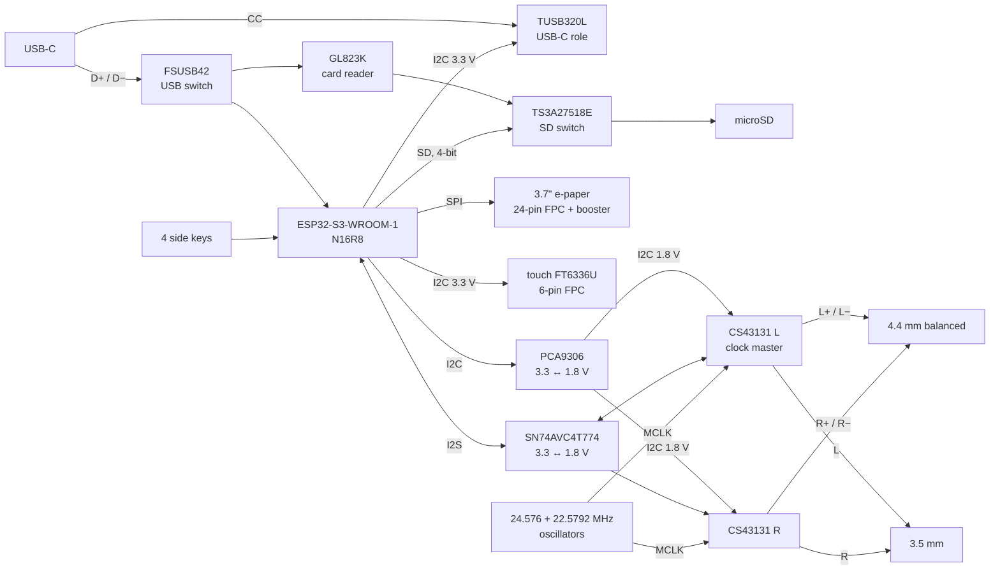
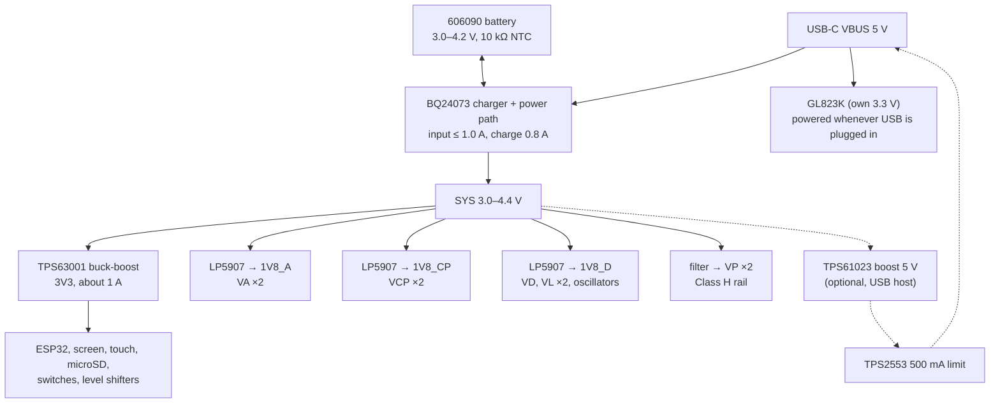

# Player board (Phase 2) — plan

Stage 1 of the board design: what is on the board, how power flows, which ESP32 pin does
what, and which parts JLCPCB can assemble. Drafted and approved 2026-10-26. Stock and prices
are from JLCPCB's parts library on 2026-10-25.

**Stage 2, the schematic, is drawn (2026-10-26):** see [Schematic](#schematic-stage-2) at the
end. It follows this plan with the changes listed there.

**Stages 3 and 4 done (2026-10-31): the board is 6 layers, 60.8 × 111.8 mm (case 65 × 116
× 17.2 mm), every part has its real footprint and LCSC number, every net is routed and
KiCad's DRC is clean.** The JLCPCB files are ready to order: see
[JLCPCB files](#jlcpcb-files-stage-4); what changed to get there is under "Routing on 6
layers" at the end.

One board, 6 layers (4 until 2026-10-31), assembled by JLCPCB on **one side** (the side facing the screen), so it
stays in their cheaper "Economic" assembly. Its outline comes from the case model
(`tools/make_case.py`): 60.8 × 111.8 mm (since 2026-10-31), with a shallow notch for the
4.4 mm jack and cut-outs for the two screw bosses.

## What changed from PROJECT.md §3

- **Charger BQ24075 → BQ24073.** Same chip family and footprint, but the BQ24073 holds its
  output at 4.4 V when USB is plugged in. The BQ24075 lets it rise to 5.5 V, above the
  CS43131's 5.25 V limit on VP. The BQ24073 has no SYSOFF pin, so "off" is a deep sleep of
  the ESP32 with the audio and other rails switched off (roughly 0.1–0.2 mA; the battery's
  own self-discharge matters more).
- **The CS43131s make the audio clocks, not the ESP32.** The 24.576 / 22.5792 MHz
  oscillators feed both DACs directly; the left DAC is the I2S clock master and the ESP32
  receives its bit and word clocks (I2S slave). The ESP32's MCLK pin is no longer used.
  The firmware's I2S code changes to slave mode.
- **Two keys move pins:** Power must be on a pin that can wake the ESP32 from deep sleep
  (GPIO 0–21), and the ESP32 has no free pins otherwise. See the pin map.

## Block diagram

- **Audio:** the two CS43131s run in mono (differential) mode, Cirrus's documented way to
  make a balanced stereo output from two chips (datasheet §4.2.3). The left chip drives L+
  and L−, the right chip R+ and R−. The 4.4 mm jack takes all four (Pentaconn order: tip L+,
  ring 1 L−, ring 2 R+, ring 3 R−, sleeve ground). The 3.5 mm jack takes only L+ and R+, so
  single-ended output is 6 dB lower, which suits the sensitive Dark Sabers anyway. Each
  jack's detect contact goes to one CS43131's HP_DETECT pin, read over I2C.
- **Clocks:** one oscillator runs at a time (24.576 MHz for 48/96/192 kHz music,
  22.5792 MHz for 44.1/88.2/176.4 kHz), chosen by OSC_SEL. Both outputs share the MCLK net.
- **Level shifting:** the CS43131's digital pins run at 1.8 V and the ESP32's at 3.3 V.
  SN74AVC4T774 (the part on Cirrus's own evaluation board) carries SCLK and LRCK to the
  ESP32 and SDIN and OSC_SEL to the 1.8 V side. PCA9306 joins the two I2C buses. RESET
  and INT sit in the CS43131's VP domain (3.0–4.4 V here), so they take 3.3 V directly.
- **USB:** normally USB goes to the ESP32 (firmware updates, serial log, and later USB
  audio out). In "USB disk" mode, USB_DISK flips both switches: the PC sees the microSD
  through the GL823K at full USB 2.0 speed while the ESP32 lets go of the card.
- **Screen:** the panel connects straight to the board through Good Display's reference
  booster circuit (what the FTS02 does now), with the 0.47 Ω sense resistor for its UC8253.

## Power tree

| Rail | From | Feeds | Switched by |
|---|---|---|---|
| SYS 3.0–4.4 V | BQ24073 OUT (battery, or USB when plugged in) | everything below | — |
| 3V3 | TPS63001 | ESP32, e-paper, touch, microSD card, TUSB320L, FSUSB42, TS3A27518E, 3.3 V side of the level shifters | always on |
| 1V8_A | LP5907 | VA of both CS43131 (the quietest rail) | AUDIO_EN |
| 1V8_CP | LP5907 | VCP (Class H charge pump) of both CS43131: Cirrus asks for VA and VCP on separate clean supplies | AUDIO_EN |
| 1V8_D | LP5907 | VD, VL of both CS43131, oscillators, inverter, 1.8 V side of the level shifters | AUDIO_EN |
| VP | SYS through a ferrite bead | Class H supply of both CS43131 (3.0–5.25 V allowed) | — (DACs held in reset) |
| 5 V out | TPS61023 + TPS2553 | VBUS when the player powers a USB DAC | BOOST_EN |

- **Charger settings:** input limit 1.0 A (R_ILIM = 1610 / 1.0 ≈ 1.6 kΩ), charge current 0.8 A
  (R_ISET = 890 / 0.8 ≈ 1.1 kΩ): a full charge takes about 5–6 hours. It's a linear charger
  in a closed case, so more current means more heat (about 1 W at 0.8 A).
- **When the player powers a USB DAC,** BOOST_EN also puts the charger in standby (EN1 high,
  EN2 tied high), so it doesn't try to charge from its own 5 V. The 5 V boost and its
  switch are optional: leave them unassembled to save cost; the rest works without them.
- **Battery life, rough:** 60–150 mA while playing (ESP32 mostly idle between buffer fills,
  Wi-Fi off) → about 25–60 hours from 4000 mAh. Measured numbers come with the prototype.

## Pin map (ESP32-S3-WROOM-1-N16R8)

Changes from the prototype (`include/pins.h`) are in bold. `pins.h` gets a board variant
when the firmware moves to this board; until then the prototype map stays.

| GPIO | Use | Notes |
|---|---|---|
| 0 | **Play key** | was 39. Boot-strap pin: holding Play while plugging in starts the firmware download mode, handy for recovery. |
| 1 | **Power key** | was 42. Can wake the ESP32 from deep sleep ("off"). |
| 2 | I2S SCLK in | from the left CS43131 via the level shifter |
| 3 | **Battery voltage** | 1 MΩ / 1 MΩ divider from BAT (ADC1) |
| 4 | I2S LRCK in | from the left CS43131 via the level shifter |
| 5 | I2S data out | to both CS43131 SDIN via the level shifter |
| 6 / 7 | I2C SDA / SCL, 3.3 V | touch (0x38), TUSB320L, PCA9306 → both CS43131 (addresses set by ADR resistors) |
| 8 – 13 | e-paper RST, DC, CS, MOSI, SCK, BUSY | same as the prototype |
| 14 – 18, 21 | microSD CLK, CMD, D0–D3 | same as the prototype, now through the SD switch |
| 19 / 20 | USB D− / D+ | through the USB switch |
| 38 | **USB_DISK** | high = microSD and USB go to the card reader |
| 39 | **DAC_RST** | both CS43131 RESET (low = reset, also the default while the ESP32 boots) |
| 40 / 41 | Vol+ / Vol− keys | same as the prototype |
| 42 | **OSC_SEL** | low = 22.5792 MHz, high = 24.576 MHz |
| 43 | debug serial TX | test pad only |
| 44 | **CHG** | charger status, also lights a small charge LED |
| 45 | **BOOST_EN** | 5 V out for a USB DAC. Pulled down: this pin must be low at boot. |
| 46 | **AUDIO_EN** | the two 1.8 V audio rails. Pulled down at boot. |
| 47 / 48 | touch INT / RST | same as the prototype |

All 33 usable pins are taken. The CS43131 and TUSB320L interrupt lines aren't wired: the
firmware polls them over I2C (headphone plugged in, USB attached). The MCLK pin (GPIO 1 on
the prototype) is reused for the Power key.

## Parts list

| Function | Part | JLCPCB no. | Stock | Each | Notes |
|---|---|---|---|---|---|
| MCU + flash + PSRAM + Wi-Fi/BT | ESP32-S3-WROOM-1-N16R8 | C2913202 | 27,240 | $5.35 | |
| DAC + headphone amp ×2 | CS43131-CNZR (QFN-40) | C965907 | 13 | $5.60 | ~8,500 more at LCSC's partner stock, 3–5 days. Order early. **0 at JLCPCB on 2026-10-31:** pre-order 4 into your JLCPCB parts inventory before ordering the boards. |
| 22.5792 MHz oscillator | SX3M22.5792M20F30TNN | C2901572 | 861 | $0.33 | 1.62–3.63 V, 3.2 × 2.5 mm |
| 24.576 MHz oscillator | SX3M24.576M20F30TNN | C2901574 | 1,749 | $0.48 | same series |
| I2S level shifter | SN74AVC4T774PWR | C129363 | 11,891 | $0.77 | |
| I2C level shifter | PCA9306DCUR | C33196 | 7,857 | $0.67 | |
| Charger + power path | BQ24073RGTR | C15220 | 30,204 | $0.88 | |
| 3.3 V buck-boost | TPS63001DRCR | C28060 | 9,131 | $1.61 | |
| 1.8 V low-noise LDO ×3 | LP5907MFX-1.8/NOPB | C92498 | 28,755 | $0.19 | |
| Oscillator select inverter | 74LVC1G04DBVR | C33962550 | 3,329 | $0.06 | runs at 1.8 V |
| USB ESD protection | USBLC6-2SC6 | C7519 | 40,920 | $0.18 | |
| E-paper booster MOSFET | SI1308EDL-T1-GE3 | C469327 | 38,173 | $0.27 | the part Good Display names |
| E-paper booster diodes ×3 | MBR0530 | C77336 | 53,880 | $0.04 | |
| USB-C role controller | TUSB320LIRWBR | C2836598 | 5,673 | $0.79 | |
| USB 2.0 switch | FSUSB42MUX | C11355 | 30,950 | $0.30 | |
| microSD bus switch | TS3A27518EPWR | C443721 | 4,382 | $0.93 | |
| USB card reader | GL823K-HCY04 | C284879 | 115,985 | $0.49 | makes its own clock, no crystal |
| 5 V boost (optional) | TPS61023DRLR | C919459 | 9,169 | $0.24 | |
| 5 V current-limit switch (optional) | TPS2553DBVR | C55266 | 49,565 | $0.54 | |
| microSD socket, push-push | TF-01A (Hroparts) | C91145 | 161,103 | $0.19 | footprint from its drawing (2026-10-31); card-detect contact not used |
| E-paper connector, 24-pin 0.5 mm | AFC07-S24FCA-00 | C262567 | 47,490 | $0.13 | bottom contact; KiCad has its footprint. Checked 2026-10-31: contact side and pin order match the ribbon folded under the panel (see below) |
| Touch connector, 6-pin 0.5 mm | AFC07-S06FCA-00 | C262553 | 31,286 | $0.11 | bottom contact, KiCad's footprint |
| Side keys ×4 | Alps SKRTLAE010, side-push 4.5 × 3.4 × 3.3 mm | C110293 | 43,836 | $0.14 | |
| 3.5 mm jack | PJ-342 (SHOU HAN) | C668606 | 71,732 | $0.18 | 3-pole stereo with a switch on tip and ring (closed while empty); 4.5 mm tall, so it sits **on the back** of the board and is **hand-soldered** |
| Battery connector | ~~JST PH 3-pin, right angle (S3B-PH-SM4-TB)~~ → 3 solder pads on the back | — | — | — | Changed in the placement draft: the JST PH is too tall for the 3.3 mm gap under the screen and has no room beside the jacks. Battery since 2026-10-31: **806090, 5000 mAh, 3 wires with 10 kΩ NTC** |
| **4.4 mm jack** | **Kinghelm KH-PJ-44002-12DBAP-A** (slim, 12 pins, plug switch) | C42396781 | 0 | — | Chosen 2026-10-31 for its full drawing. Not stocked by JLCPCB: **buy it** (Taobao 金航标 or LCSC) and hand-solder it **on the back** of the board. 21 mm long with its nose. |
| USB-C, 16-pin | TYPE-C-31-M-12 (top mount) | C165948 | 283,819 | $0.19 | Top-mount kept; since 2026-10-31 the case puts every port's hole at its own part's height |
| E-paper booster | Good Display reference circuit | — | — | — | inductor, N-MOSFET, 3 Schottky diodes, 0.47 Ω, ~10 × 1 µF/25 V; values from the panel's spec in stage 2 |
| Resistors, capacitors, inductors, ferrite, LED | ~105, each with its LCSC number in `tools/make_schematic.py` (PASSIVES), checked on lcsc.com 2026-10-31 | — | — | — | mostly JLCPCB Basic parts. LCSC had only 40 of the 10 µH inductor (C354566) |

About 25 different Extended parts: at JLCPCB's current $1.50–3 loading fee each, that's
roughly $40–75 per order on top of the parts, board and assembly.

## Board layout idea (stage 3)

- **Top edge (audio corner):** jacks, USB-C, both CS43131s, oscillators and the 1.8 V LDOs,
  with short output traces to the jacks. No switching regulator near here.
- **Middle:** ESP32 module, I2C/I2S level shifters. **Lower right:** charger, buck-boost and
  the optional 5 V boost. **Bottom:** the screen and touch connectors (the ribbons fold back
  at the panel's bottom edge), microSD socket, card reader and SD switch.
- **Layers** (6 since 2026-10-31, see Routing): 1 parts and signals (facing the screen),
  2 solid ground, 3 and 4 signals with ground poured around them, 5 solid ground, 6 signals
  and a 3.3 V fill. Power runs as wide tracks.
- **Height limit:** parts on the board must stay under 3.3 mm, the gap to the screen. The
  ESP32 module (3.1 mm) and the side switches (3.3 mm) are at the limit. The case script
  will check every part with its real height in stage 3.

## Open items

1. ✅ **4.4 mm jack (2026-10-31):** Kinghelm KH-PJ-44002-12DBAP-A, from its drawing. A 4.4 mm
   plug is 19.5 mm long (JEITA RC-8141C), so the jack is about 21 mm deep with its nose, not
   the 14 mm the first case assumed: see "Finishing stages 3 and 4" below.
2. ✅ **USB-C (2026-10-31):** the top-mount TYPE-C-31-M-12 stays; the case's hole is at its height.
3. ✅ **Battery:** three solder pads on the back; the battery is now an **806090, 5000 mAh,
   3 wires with a 10 kΩ NTC** (owner's choice, 2026-10-31).
4. ✅ **Optional 5 V output:** kept on the board (2026-10-26).
5. ✅ **Wi-Fi/Bluetooth antenna (2026-10-31): keep the WROOM-1 and its PCB antenna for the
   first order** (owner's choice). Its range will be poor, since the battery's foil sits
   right under the antenna, but wireless is only for firmware updates and the clock: music
   and books come over USB, and the ESP32-S3 has no Bluetooth audio for headphones. The
   WROOM-1U with a stick-on antenna doesn't fix it in this case either: the only metal-free
   spot, above the screen, is next to the jacks and DACs. Measure the range on the first
   boards; if it is too short, the WROOM-1U goes into the next revision.
6. ✅ Settled in stage 2: the e-paper booster values, the headphone-detect wiring and the
   GL823K power. Checked 2026-10-31 against the datasheets: see below.

## Schematic (stage 2)

Drawn 2026-10-26 in `hardware/` (KiCad 10): open `hardware/dap.kicad_pro`, or read
`hardware/dap_schematic.pdf`. Six pages: the top sheet, then Power, MCU, Display, USB and
storage, Audio. 158 parts, 126 nets.

The sheets are generated by `tools/make_schematic.py` from one table of parts and
connections, so edit that and re-run (`python3 tools/make_schematic.py`) rather than
editing the sheets in KiCad; a re-run overwrites them. Each run also checks itself:

- KiCad's electrical rules check (ERC): 0 errors, 0 warnings.
- KiCad's own netlist is read back and compared with the table: every intended net is
  exactly one KiCad net, none split, none merged. A deliberately broken label is caught,
  which ERC alone misses.

**Changes from the plan above, made while drawing:**
- **Third 1.8 V LDO** for VCP: Cirrus asks for VA and VCP on independent clean supplies.
- **No 12 MHz crystal:** the GL823K makes its own clock. It runs from VBUS whenever USB is
  plugged in (about 45 mA from the PC), so it needs no power switch.
- **Charger EN2 tied to SYS,** not 3.3 V: otherwise a flat battery would start the charger in
  its 100 mA mode, which may not be enough to boot the player.
- **USB ESD protection** (USBLC6-2SC6) on D+/D− and VBUS.

**How the main circuits are wired** (all on the sheets):
- CS43131: every capacitor from Cirrus's typical connection diagram (FILT+ 15 µF to VA,
  FILT− 15 µF to −VA, 2.2 µF flying and filter caps, VP 0.1 + 4.7 µF), mono mode, the left
  chip at I2C address bits 00 (ADR to ground), the right chip at 01 (4.99 kΩ to ground).
  HPREFA/B go to the jack ground net HP_GND, which meets GND through a net tie at the jacks
  so it can be routed on its own.
- Headphone detect: each jack's detect contact goes to one CS43131's HP_DETECT (3.5 mm to the
  left chip, 4.4 mm to the right). The pin reads low when the contact touches a plug's tip,
  as Cirrus describes.
- Touch connector pins from Good Display's TP037-S02 drawing: 1 GND, 2 VDD, 3 RST, 4 INT,
  5 SDA, 6 SCL.
- E-paper: Good Display's reference circuit (10 µH, Si1308EDL, three MBR0530, 0.47 Ω
  sense, 1 µF/50 V on every rail).
- TUSB320L: dual role (PORT open), I2C address 0x47, 887 kΩ to VBUS_DET. It shows a 5.1 kΩ
  pull-down even unpowered, so a USB-C charger still turns on with a flat battery.

**To check in stage 3 (layout), with each part's drawing:**
- Footprints for the two jacks (custom), the microSD socket and 6-pin FPC (stand-ins now),
  and which side the 24-pin FPC contacts face once the panel ribbon is folded.
- The jacks' detect contact: it must touch the tip when a plug is in. The 4.4 mm jack isn't
  chosen yet.
- Oscillator OE polarity (assumed high = running) and that its output goes high-impedance
  when off, since the two outputs share MCLK.
- GL823K VDD and VDDA are tied together as its internal 3.3 V; check against a Genesys
  reference design.
- 15 µF capacitors in 0805: not found under the first part number tried; pick one or use 22 µF.

## Placement draft (stage 3)

Placed 2026-10-26 in `hardware/dap.kicad_pcb`: all 158 parts on a 1.2 mm board (4 layers then, 6 since 2026-10-31)
cut to the case's outline (60.8 × 105.8 mm, jack notches, screw-boss corners). Routing is
under way, see the next section. Renders: `hardware/renders/pcb_top.png`, `pcb_angle.png`, `pcb_bottom.png`;
in KiCad, open the board and press Alt+3 (View → 3D Viewer) to turn it around.

Made by `tools/make_pcb.py` from the schematic's netlist, so run it after
`make_schematic.py` (it needs KiCad's own Python, see the script's first lines). Big parts
sit where its PLACE table puts them, following the layout idea above; each group's small
parts are packed as close as they fit to the pins they connect to. It also writes the
stand-in footprints (`hardware/dap.pretty`), simple 3D models for parts KiCad has none
for (`hardware/3d`), and JLCPCB's limits as design rules (`hardware/dap.kicad_dru`).
DRC: no clearance, courtyard or edge problems, apart from the connections not routed yet
and KiCad's own footprint for the side keys (its peg sits close to its pads).

**Decisions made while placing (change them if you disagree):**
- **ESP32 antenna at the left edge,** module centre 8 mm below the board's middle. The
  footprint asks for no copper and no parts in a 6 × 48 mm strip beside the antenna; the
  strip ends just under the Vol− key.
- **USB-C top-mount** (the part in the list), at the top edge with no notch. The case's
  USB-C hole has to move up about 3 mm (open item 2).
- **Battery wires solder to three pads** (+, −, NTC) on the back, between the 3.5 mm jack
  and USB-C, right above the battery's end. The JST PH plug didn't fit anywhere (open
  item 3).

**Stand-ins to replace once the parts are chosen:** both jacks (boxes from the case
estimate, mid-mount in their notches), the microSD socket (Hirose DM3D footprint), the
6-pin touch connector (Hirose FH12), and box models for USB-C, side keys and the 24-pin FPC.
The real FPC positions also depend on where the panel's and touch film's ribbons come out.

## Routing (stage 3)

Started 2026-10-26, finished 2026-10-31. `tools/make_pcb.py` routes in three steps, all part
of the same script, so everything is redone whenever the schematic or the placement changes
(a full run takes about 20 minutes):

1. **Its own router** (`tools/pcb_router.py`) routes every net: 45° tracks on the four signal
   layers (1, 3, 4 and 6; the USB pairs on 1 and 6 only), through vias 0.5/0.3 mm, clearances
   checked on a 0.025 mm grid. First a via beside every ground pin and a short escape stub
   out of every fine-pitch pin (chips, the two FPC connectors and every pin of the ESP32
   module). Then each such pin gets **a via of its own** a short way out, taken round each
   chip in turn so they stagger: first the pins of nets that leave their chip, then, where
   room is left, the local nets' pins (a pin that finds no room has its local neighbours'
   vias taken back, so they leave side by side on the top layer). A track routed early can
   then never wall a pin in, which is what kept the 4-layer board from finishing. Then the
   short local nets (a chip and its capacitors, feedback dividers: pins within 8 mm), USB,
   audio, power and all other nets, in that order. Each search is A* **guided by the true
   distance to its goal through free space** (Dijkstra over the search window, in SciPy), so
   it goes straight round obstacles; before, long searches ran out of steps. Each net still
   stuck then gets **a trial rip-up**: the nets routed near its pins are taken up, with their
   pin vias there, it is routed first with a bigger search budget, then they are routed
   again; the result is kept only if fewer connections are left unmade, otherwise everything
   goes back exactly as it was. Rounds of this go on while they help. Pin vias left unused
   are taken away. Strips above and below each CS43131 are reserved channels: only its
   headphone nets above, only its I2S, clock and I2C below.
2. **Freerouting** (2.5.0, the Java version: `tools/freerouting.nosync/freerouting-2.5.0.jar`,
   downloaded from its GitHub release and checked against the published SHA-256, run with
   its usage statistics off; not in git) for anything still unrouted, with all of ours as
   fixed wiring (since 2026-10-31: allowed to redo ours, it undid more than it added). Skipped
   when nothing is left, as now.
3. **Clean-up and repair:** neck-downs below 0.1 mm are widened, dead-end tracks and vias
   are removed one at a time, each removal kept only if KiCad's count of unrouted
   connections stays the same (a track with one open end can still carry another that ends
   partway along it). For each connection KiCad still finds open, our router then tries a
   direct track between the two ends KiCad names, then the trial rip-up, each kept only if
   KiCad's own count drops (`python tools/make_pcb.py --repair` runs only this step). On the
   current board nothing is left for it.

- **Ground:** solid planes on layers 2 and 5 under the whole board (none under the ESP32's
  antenna), and ground poured around the tracks on layers 3 and 4. Every ground pin reaches them: a via beside the pin, vias inside the exposed
  pads (4 under the charger), and the CS43131's ground pins tied into their own centre pad.
- **USB, routed first** (the socket's pins leave no room to spare): D+/D− from the socket
  through the ESD chip to the USB switch as a pair, 0.2 mm tracks 0.2 mm apart, on the top
  and bottom layers only (about 90 Ω over the ground plane 0.0994 mm away in JLCPCB's
  free stackup JLC06121H-3313), then on to the
  card reader and the ESP32. The socket's two D− pins straddle a D+ pin, so they are
  joined on the bottom layer. CC1/CC2 to the TUSB320L. Pair lengths: 70/75 mm to the switch
  (4.5 mm apart, about 30 ps: more than USB 2.0 layout guides like, small next to a 2 ns
  bit), 18/17 mm to the card reader, 9/11 mm to the ESP32.
- **Audio:** master clock (kept 0.2 mm from other nets), the four headphone outputs
  (0.3 mm wide where there is room), headphone ground (0.5 mm) to both jacks and the net
  tie, jack detect, I2S on both sides of the level shifter, oscillator select.
- **Power** (after the signals): the switching nodes of the buck-boost, the 5 V boost and
  the e-paper booster first, kept short; then each rail from its source as a tree of wide
  tracks: VBAT, SYS and VBUS 0.4–0.8 mm, 5 V 0.4–0.6 mm, 3.3 V and VP 0.3–0.5 mm, the 1.8 V
  rails 0.25–0.4 mm. Tracks narrow to 0.15 mm only where they leave a fine-pitch pin. On top
  of its tracks, 3.3 V fills the free area of the bottom layer (about 5,600 mm²).
- **Control and data lines** (I2C, keys, enable and reset lines, e-paper, microSD, charger
  settings, battery sense): last, 0.15–0.2 mm tracks.
- **Check (2026-10-31):** every connection routed; KiCad's DRC finds no clearance, width,
  edge, dangling or unconnected problems (the only reports are inside KiCad's own footprint
  for the side keys, whose peg sits close to its pads, and four silkscreen notes at the
  board edge). 395 vias, 3.5 m of track, nothing narrower than 0.15 mm. The side keys' two
  pads "1" (joined inside the switch) are also joined by a track, as KiCad asks.
  History: on 2026-10-27, on 4 layers, 28 connections were left.

**Placement changes made for routing:** the CS43131s are turned 180° so their outputs face
the jacks, strips above and below them are kept free of small parts, the stand-in
jacks have most pins in a row behind the jack (where the DAC tracks arrive), and the
battery pads moved 2 mm towards the top edge to leave room for a ground via. Later the
same day: small parts keep 0.8 mm beyond the outline of every chip with 0.5 mm pitch or
finer (room for the tracks fanning out of its pins), each two-pad part is turned so its
pads face the pins of their own nets, and a strip in front of the e-paper connector's
signal pins (9-14) is kept free. On 2026-10-31: the ring kept free round each CS43131 is
0.6 mm (was 1.4), parts that sit between two pins of their chip (the flying and filter
capacitors) are placed first, right at those pins, and a strip in front of the
charge-pump pins 22-26 is kept free for their tracks and vias.

**Decided 2026-10-26: layer 3 is a second ground plane.** The long USB pair runs on the
bottom layer, and high-speed USB needs ground on the layer next to it; the plan had layer 3
for power. Power runs as wide tracks and the bottom layer's 3.3 V fill instead.

**Decided 2026-10-31: 6 layers** (owner's choice over dropping features): 1 top, 2 ground,
3 and 4 signals, 5 ground, 6 bottom. Layer 2 is the top layer's reference, layer 5 the
bottom's, so the USB pairs keep a solid ground beside them on either outer layer.

## Case with the real board

`tools/make_pcb.py` also writes the board as a 3D model, `case/pcb.glb` (not in git: 27 MB,
rebuilt each run). `tools/make_case.py` puts it into the case in place of the stand-in boxes
(`-- --dummy-board` brings the boxes back), checks it and renders `case/renders/inside.png`
(the board through the clear shell, panel taken out) besides the other views.

- **Height check:** no part of the board reaches into the panel's layer (the 3.3 mm gap).
- **USB-C hole:** the board uses the top-mount USB-C from the parts list, about 3 mm higher
  than the case's hole (made for a mid-mount one), so the top-edge render shows an empty
  hole. Move the hole up in the case script, or find a mid-mount USB-C (open item 2).

## JLCPCB files (stage 4)

`python3 tools/make_jlc.py` writes `hardware/jlcpcb/`: Gerbers and drill files in one zip,
the BOM (`dap-bom.csv`, JLCPCB's columns) and the placement file (`dap-cpl.csv`), plus
`readiness.txt`, which lists what still blocks ordering and the order settings. While
anything blocks it, the zip is named `dap-gerbers-DRAFT.zip`.

- **Order settings:** 6 layers, 1.2 mm, 60.8 × 111.8 mm; **ENIG** finish (flat pads for the
  0.4 mm-pitch QFNs; HASL is too uneven for them); JLCPCB's free 6-layer stackup
  JLC06121H-3313 (1.14 mm finished; the USB pairs are drawn for its 0.0994 mm outer prepreg);
  tracks/gaps 0.1 mm; vias 0.5/0.3 mm, filled and capped (free on 6 layers); parts on the
  top side only.
- **No hole under 0.3 mm (2026-10-31):** KiCad's footprints have 0.2 mm thermal vias in the
  chips' centre pads (both CS43131s, the TPS63001, the ESP32 module). 嘉立创 charged ¥229
  more for them (small holes, plus a four-wire test and TG155 material it then requires), so
  `make_pcb.py` widens them to 0.3 mm (`MIN_HOLE`), pads unchanged; DRC still clean.
- **Not assembled by JLCPCB:** the 4.4 mm jack (hand-soldered), the battery wires, the
  test pads and the net tie.
- **Ready to order (2026-10-31):** nothing blocks it (`readiness.txt`: READY TO ORDER,
  `dap-gerbers.zip`). Before ordering: pre-order 4 CS43131 into the JLCPCB parts inventory
  (none in stock), and check the touch ribbon's contact side.
- **Ordering through 嘉立创 (jlc-smt.com), JLC's site in China** (owner's choice, 2026-10-31):
  it ships to the 集运 warehouse with the Taobao parcels. Its forms are in Chinese; the
  steps, field by field with the English meaning, are at the end of `readiness.txt`. It reads
  no KiCad files, so the assembly order takes `dap-bom-cn.csv` and `dap-cpl-cn.csv`, written
  after its BOM rules (Comment, Designator, Footprint and the part number as 商品编号; plain
  package names). Under 元器件备货方式 pick **嘉立创代采代购**: JLC buys every part,
  including the CS43131 it doesn't stock; parts can also be bought ahead into its private
  stock (私有库存). The board order (6 layers, 1.2 mm, 沉金 ENIG, 过孔盖油) goes in first,
  on member.jlc.com, and the assembly order is attached to it. History: on 2026-10-27 the
  unrouted connections, stand-in footprints, missing LCSC numbers and open datasheet checks
  blocked it; all are done.
- In JLCPCB's placement preview, check each part's rotation: some library parts are drawn
  turned 90° or 180° from KiCad's footprints.

## Finishing stages 3 and 4 (2026-10-31)

**Board and case size.** The owner moved to a 5000 mAh cell (806090: 8 × 60 × 90 mm, three
wires with a 10 kΩ NTC). Real 4.4 mm jacks are about 21 mm deep with their nose (the
Pentaconn plug is 19.5 mm long), so the 14 mm jack area of the first case could never hold
one. Both headphone jacks now hang from the **back** of the board into the top end, where
the battery isn't: the case is **65 × 116 × 17.2 mm** (owner's choice over a 110 mm case with
a shorter, thicker cell) and the board **60.8 × 111.8 mm**. The battery lies between the
4.4 mm jack (1.5 mm away) and the back cover's hooks (0.3 mm), and its wires reach the pads
on the back just past its end.

**Parts with real footprints now** (the generated ones in `hardware/dap.pretty`, from each
maker's drawing; pad positions cross-checked with JLCPCB's EasyEDA library):
- **3.5 mm jack, SHOU HAN PJ-342 (C668606), on the back, hand-soldered.** Its drawing shows a
  3-pole stereo jack, not 4-pole: tip 3, ring 6, pins 5 and 2 on the sleeve end, and a
  switch on tip and ring that is closed while no plug is in (4 and 7). Tip → OUT_LP, ring →
  OUT_RP, 5/2 → HP_GND, 4 → DET_35, 7 unused. Its front face sits on the board edge, the
  2 mm nose ends 0.1 mm inside the case's face; two 1.5 mm pegs go through the board.
- **4.4 mm jack, Kinghelm KH-PJ-44002-12DBAP-A (C42396781), on the back, hand-soldered.**
  Slim (6.5 × 5 mm, axis 2.5 mm off its seat), 12 slotted pins, two per pole in Pentaconn
  order (1/6 ground, 2/7 R−, 3/8 R+, 4/9 L−, 5/10 L+) and a separate plug switch 11–12. Its
  front face overhangs a 1.15 mm notch in the board edge by 0.25 mm, as its drawing asks,
  so the 2.8 mm nose ends 0.2 mm inside the case's face. The drawing's clearance hole for
  the plug switch is cut through the board, with a keep-out around it for the routers.
- **microSD, Hroparts TF-01A (C91145):** pads 1–8, four shell tabs (SH, ground), the
  card-detect contact (CD) not used. The card mouth sits at the board's bottom edge, x 18.5
  mm (moved 2.5 mm right to clear the e-paper connector).
- **Touch connector:** KiCad's Jushuo AFC07-S06FCA-00 footprint.

**Datasheet checks** (the four left open in stage 2, and two more found on the way):
- **Oscillators** (SCTF SX3M): pin 1 is tri-state, "output enabled when logic 1 or open,
  disabled when logic 0": OE high = running, and the off one's output is high-impedance,
  so the two can share MCLK. Pinout 1 OE, 2 GND, 3 out, 4 Vdd matches the symbol.
- **GL823K:** VDDA (USB PHY) and VDD (digital) are both its 3.3 V supplies, made by its
  own 5 V → 3.3 V regulator from the 5V pin: tied together with 1 µF + 100 nF, as drawn.
- **CS43131 FILT± capacitors:** Cirrus gives 15 µF as nominal, low-ESR X5R/X7R. Now **22 µF
  0805, 25 V** (the same part as the other 22 µF): about 15–19 µF left at 1.8 V of bias,
  where a 15 µF part would keep about 11 µF.
- **Headphone detect:** Cirrus wants a sense contact that floats with no plug and touches
  the tip with one; HP_DETECT has a weak internal pull-up, reads low when tied to the
  amplifier output, and its polarity can be inverted (HPDETECT_INV). The PJ-342's tip
  switch does the opposite (touches the tip while empty), so the 3.5 mm side needs
  HPDETECT_INV = 1. The Kinghelm's plug switch is separate: one side to ground, the other
  to DET_44; its polarity is set the same way once tried. While only the 4.4 mm jack is in
  use, the 3.5 mm detect input sees the left output's audio; it only reaches the 2.0 V
  input threshold near full scale, and the debounce filters that.
- **E-paper ribbon** (GDEY037T03-T02 spec: drawing p. 6, reference circuit p. 35): the
  ribbon's gold faces the display side, so folded under the panel it faces the board:
  bottom-contact connector, as placed. Seen from the front with the ribbon at the bottom,
  its pin 1 is on the left, and so is the connector's pin 1: the order matches. Its centre
  is 0.4 mm left of the panel's centre (measured on the drawing, ±0.3 mm), so the connector
  moved from x −2.0 to **−0.4 mm**: the 1 cm ribbon can't take up 1.6 mm sideways.
- **E-paper reference circuit:** pin 19 (VPP) is left open and the MOSFET gate pull-down is
  1 MΩ in this panel's reference circuit; the board had a 1 µF on VPP and 10 kΩ. Both now as
  the reference; R1 and R2 (1 MΩ, 0.47 Ω) are 0603 as its parts table asks.

**LCSC numbers for every part** (`PASSIVES` in `tools/make_schematic.py`, checked on
lcsc.com): UNI-ROYAL 1 % resistors, Samsung X5R/X7R capacitors, Cenker inductors in the
footprints already used, Murata BLM18KG601SN1D ferrite (1.3 A) on VP, Everlight green LED.
49.9 kΩ (TPS2553 current limit) had no stock: 47 kΩ, ~0.5 A. Stock at JLCPCB itself on
2026-10-31: every assembled part had some except the **CS43131 (0)**: pre-order 4 into the
JLCPCB parts inventory before ordering. LCSC had only 40 of the 10 µH inductor.

**Ordering:** JLCPCB makes at least 5 boards per order and assembles 2 or more of them
(Economic assembly: 2–50 boards, one side, 2/4/6 layers, 0.8–1.6 mm). Order 5, assemble 2.

**Routing on 4 layers (2026-10-31): not finished.** Seven full runs (about an hour each) with
the real parts left between 21 and 37 connections unrouted, always in the same places: the
two DACs' bus, clock and charge-pump nets, the I2C and I2S lines that cross the audio area,
the headphone lines to the 4.4 mm jack, and a few enable lines at the charger. What was
tried: our router for local nets, buses and rails with Freerouting for the rest (21–27);
Freerouting allowed on layer 3 as well, ground poured around its tracks there but kept whole
under the USB pairs (23); our router for the critical nets only and Freerouting for all
else, with track widths from net classes (37); a 1.4 mm ring kept free around each DAC for
its pins (27); the clocks, level shifters and 1.8 V regulators moved to a column between
the DACs, so shared buses and rails fan out both ways (now in place); and Freerouting
allowed to rip up everything but the critical nets (32). Freerouting stops improving after
about 7 passes and reports 87–129 "unfixable violations" in the locked copper, so it avoids
whole areas. The board is DRC clean apart from the unrouted connections.

**Routing on 6 layers (2026-10-31): finished.** The two extra layers alone didn't do it
(27 left on the first try, the same places as on 4 layers), because the routers weren't
short of room: they ran out of search steps, or a pin had been walled in. What finished it:
- **The search is guided by the true distance** through free space (Dijkstra over its
  window) instead of the straight line, so it goes round obstacles at once. Four long nets
  that used to fail after a minute each now route in 4 seconds together.
- **Pins get their own vias before routing** (chips, FPC connectors, the ESP32 module), so
  no track routed earlier can wall a pin in; a pin with no room takes its neighbours'.
- **Trial rip-ups that are undone unless they help**, and that may also move neighbouring
  pins' vias; the old rip-up (always kept) went back and forth.
- **DAC capacitors right at their pins**, see the placement changes above.
- **Freerouting only adds**, with all our tracks fixed; allowed to redo ours, it lost more
  than it made. On the current board it isn't needed at all.
- **Clean-up that can't cut a connection**, and a pin via that a track on another layer
  runs across counts as used (removing one had cut the charger's second SYS pin off).
A full run now takes about 20 minutes.
