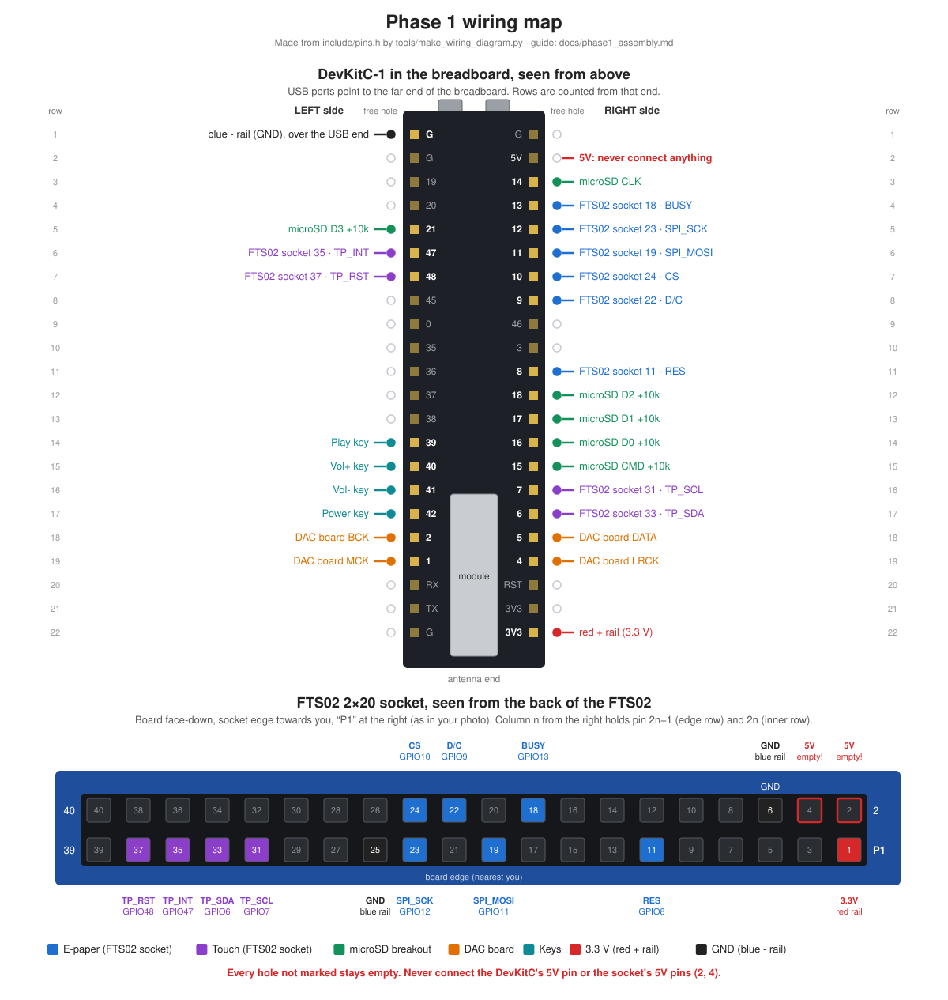

# Phase 1 assembly guide (breadboard prototype)

This guide puts the Phase 1 parts together on the breadboard one subsystem at a time, testing each before adding the next (PROJECT.md §6). At the end the DevKitC drives the e-paper and touch (through the FTS02), the microSD breakout, the CS4398 DAC board and four keys.

The pin numbers come from `include/pins.h`, the only authoritative pin map. If this guide and `pins.h` ever disagree, `pins.h` wins: rerun `uv run tools/make_wiring_diagram.py` and follow the new diagram.



Order: 0 preparation → 1 DevKitC and power → 2 screen and touch → 3 microSD → 4 DAC → 5 keys. Steps 1 and 2 need only the parts in your photo. Step 3 needs the microSD breakout, the card and the resistors. Step 4 plays music from the card, so it comes after step 3.

---

## 0. Preparation

### 0.1 Parts

| Part | In the photo of 2026-10-26 | Step |
|---|---|---|
| ESP32-S3-DevKitC-1 N16R8 (black, two USB-C ports) | yes | all |
| Breadboard on the black plate (2 terminal strips, 4 power rails) | yes | all |
| GDEY037T03-T02 panel with touch layer | yes | 2 |
| ESP32-FTS02 adapter (blue) | yes | 2 |
| CS4398 DAC board (green) and the loose 6-pin header next to it | yes | 4 |
| Jumper wires: female–female, male–female, male–male | yes | all |
| Cream block with the long white ribbon | yes | not used (a ribbon extension) |
| microSD breakout, 9 pins, pass-through | **not in the photo** | 3 |
| microSD card, 128 GB | maybe: a card sits in the FTS02's own slot | 3 |
| 10 kΩ resistors, 5 | **not in the photo** | 3 |
| 6×6 mm tactile buttons, 4 | **not in the photo** | 5 |
| USB-C cables, 2 (the DevKitC one must carry data) | — | all |

Also useful: masking tape and a pen for labels, a box or book 3–4 cm thick to stand the FTS02 on, a few sheets of paper or thin card, flush cutters, and a multimeter if you have one. For step 4: the T12 iron, 63/37 solder and something heat-proof to work on.

### 0.2 Which jumper wires go where

| Connection | Wire type | Length | How many |
|---|---|---|---|
| Breadboard ↔ FTS02 socket | male–male | 20 cm | 13 |
| Breadboard ↔ breadboard (power, microSD, keys) | male–male | 10 cm | about 16 |
| DAC board header ↔ breadboard | male–female (female end on the DAC pin) | 10–20 cm | 5 |

The female–female wires aren't needed.

Colours: use **red only for 3.3 V** and **black only for GND**. Use any other colour for signals. Pull wires off the ribbon one at a time. A small masking-tape flag with the signal name (e.g. "CS") on each wire saves a lot of re-checking.

### 0.3 How the breadboard is connected inside

- Each terminal strip has numbered rows. In one row, the 5 holes on one side of the centre groove are connected to each other, and so are the 5 holes on the other side. Nothing crosses the groove.
- The power rails are the long lines marked red **+** and blue **−**. Every hole along one line is connected. On some long breadboards the line is cut halfway (the printed line has a gap). If yours has a gap, join the two halves with a short wire, red to red and blue to blue.
- Never put two pins of a part in the same 5-hole row unless they are meant to be connected. A pin header always goes in along a column, one pin per row.
- This build uses the **left terminal strip** and the **rail pair just to its right** (between the two strips): red + = 3.3 V, blue − = GND. The other strip and rails stay empty.
- Loose boards (FTS02, DAC board) lie on the cutting mat or a box, never on the bare metal plate, where pins on their underside could short.

### 0.4 Rules for every step

1. **Unplug every USB cable before you add, move or remove a wire.** Plug back in only after checking.
2. Check every new wire against its table, both ends, before powering up.
3. **3.3 V only.** Nothing ever goes on the DevKitC's **5V** pin (right side, row 2) or on the FTS02 socket's pins **2 and 4** (5 V). 5 V can destroy the panel, the SD card and the ESP32's inputs.
4. Touch something metal and grounded (a radiator, the Mac's metal case) before handling the panel or the FTS02.
5. Plug or unplug the panel's ribbons only with the power off.

### 0.5 Prepare the microSD card (on the Mac)

1. If a card is in the FTS02's own slot (back of the FTS02, by "Micro SD"), take it out: pull it straight out, or push once to release it if it doesn't come. That slot isn't used, and a card in it would sit on the e-paper's SPI wires.
2. Format it as FAT32. **⚠ This erases the card.**
   - Insert the card into the Mac. Open **Disk Utility**, then choose **View → Show All Devices**.
   - In the sidebar select the card's **top line** (the device, about 128 GB, not the volume under it). Check the size, so you don't erase another disk.
   - Click **Erase**: Name `DAPSD`, Format **MS-DOS (FAT)**, Scheme **Master Boot Record**, then **Erase**. On a card this size, MS-DOS (FAT) is FAT32. Cards come as exFAT, which the firmware can't read.
3. Copy test files to the card's top folder:
   - any big file (20 MB or more, e.g. a FLAC track) for the speed test;
   - `test.wav`, `test.mp3` and `test.flac` at 44.1 kHz for the DAC test. Make them from any song you have, replacing `song.flac` with its path:

```bash
ffmpeg -i "song.flac" -vn -t 60 -ar 44100 -sample_fmt s16 /Volumes/DAPSD/test.wav
```
```bash
ffmpeg -i "song.flac" -vn -t 60 -ar 44100 -b:a 320k /Volumes/DAPSD/test.mp3
```
```bash
ffmpeg -i "song.flac" -vn -t 60 -ar 44100 -sample_fmt s16 /Volumes/DAPSD/test.flac
```

4. Eject the card in Finder before pulling it out.

### 0.6 Uploading a test

Run these in the project folder. In a plain terminal, `pio` is at `~/.platformio/penv/bin/pio`. `<env>` is the test's name, given in each step:

```bash
~/.platformio/penv/bin/pio run -e <env> -t upload
```
```bash
~/.platformio/penv/bin/pio device monitor
```

Ctrl+C leaves the monitor. Use the DevKitC's native **USB** port, the same one you used for the selftest on 2026-10-16. Most tests print again when you type `r`.

---

## 1. DevKitC in the breadboard, power rails

You need: the DevKitC, 1 red and 1 black male–male 10 cm wire.

1. Lay the breadboard as in your photo: long side pointing away from you. The **far end** is the end with the three round holes in the black plate.
2. Hold the DevKitC component side up (the metal-covered module and the printed pin labels on top, the header pins pointing down), with the USB ports towards the far end.
3. Hold it over the far end of the **left terminal strip** so the board straddles the centre groove: one row of pins on each side, and the first pair of pins (next to the USB ports) in the first row. Before pressing, look along each row of pins. **On both sides exactly one free hole must stay uncovered outside the pins** (the board covers the rest). If one side has none, the board is in the wrong columns: lift it and shift it.
4. Press it in. Put your thumbs on both long edges near the headers and push evenly, a little at the USB end, then a little at the antenna end, until the header plastic sits on the breadboard. It takes a firm push. Don't press on the module's metal cover, the buttons or the antenna.
5. From here on, **"left side, row 6"** means the 6th pin from the USB end on the left side. **"The free hole beside it"** means the outermost hole of that row, just outside the board's edge: that's where the wire goes.
6. Compare the printed labels with the diagram. Left side from the USB end: G, G, 19, 20, 21, 47, 48 … Right side: G, 5V, 14, 13, 12 … If your board prints something different, stop and tell me. Then follow the board's labels, not the diagram.
7. Power wires:

| Wire | From (free hole beside…) | To |
|---|---|---|
| red | **3V3**, right side, row 22 (the last pin at the antenna end) | any hole on the **red +** line of the rail pair right of the strip |
| black | **G**, left side, row 1 | any hole on the **blue −** line of the same rail pair (run it across the USB end of the board) |

GND is taken from the left side on purpose. On the right side row 1 is G but row 2 is 5V, so a one-row slip there would short 5 V to ground. On the left, rows 1 and 2 are both G.

8. Check the rails for a gap halfway down (0.3) and bridge it if there is one.
9. Test with `selftest` (upload, then monitor). It passes as on 2026-10-16: 16 MB flash, 8 MB PSRAM, the LED lights red, and "Pins: 25 free, 0 with something attached, 0 faults". If the board gets warm or the Mac complains about USB power, unplug at once and check the red and black wires.

---

## 2. Screen and touch (FTS02 + panel)

You need: the FTS02, the panel, 13 male–male 20 cm wires (1 red, 2 black, 10 other colours), the box or book, and some paper.

The FTS02's socket is on its back and the panel's ribbon is only about 1 cm long. Once the panel is plugged in you don't want to turn the board over again, so all 13 wires (screen and touch) go in now. The two tests still run one at a time.

### 2.1 Prepare the FTS02 (front side up)

- **Resistor switch:** the small slide switch between the "2.2" and "0.47" labels, near the strip printed "9560890A_P8_260813". Slide it to **0.47**, with a fingernail or a toothpick. 0.47 is for UC8253 panels like this one. 2.2 is for SSD panels.
- Leave the **Front Light** section alone: the DIP switch, the FL-SET switch, the FL-FPC connector and the FTS02's USB-C (plug nothing into it, since this panel has no front light).
- If a card is still in the slot on the back, take it out (0.5).

### 2.2 Wire the socket (FTS02 face-down)

1. Turn the FTS02 face-down on the mat with the socket edge towards you and "P1" at the right, as in your photo and in the lower half of the wiring map.
2. To find a pin: the row along the board edge holds the odd pins 1, 3 … 39, and pin 1 is the right-hand corner by "P1". The inner row holds the even pins 2, 4 … 40. Counting columns from the right, **column n holds pin 2n−1 (edge row) and pin 2n (inner row)**. "GND" is printed above inner-row column 3, which is pin 6: use it to check your counting.
3. Push the male end of each wire fully into its socket hole. Leave the other ends loose for now, each with its label.

| # | Signal | Socket pin | Where in the socket | Wire | Breadboard end (2.3) |
|---|---|---|---|---|---|
| 1 | 3.3 V | 1 | column 1, edge row (corner by P1) | red | red + rail |
| 2 | GND | 6 | column 3, inner row (under "GND") | black | blue − rail |
| 3 | GND | 25 | column 13, edge row | black | blue − rail |
| 4 | RES | 11 | column 6, edge row | any | free hole beside **8**, right side, row 11 |
| 5 | BUSY | 18 | column 9, inner row | any | beside **13**, right side, row 4 |
| 6 | SPI_MOSI | 19 | column 10, edge row | any | beside **11**, right side, row 6 |
| 7 | D/C | 22 | column 11, inner row | any | beside **9**, right side, row 8 |
| 8 | SPI_SCK | 23 | column 12, edge row | any | beside **12**, right side, row 5 |
| 9 | CS | 24 | column 12, inner row | any | beside **10**, right side, row 7 |
| 10 | TP_SCL | 31 | column 16, edge row | any | beside **7**, right side, row 16 |
| 11 | TP_SDA | 33 | column 17, edge row | any | beside **6**, right side, row 17 |
| 12 | TP_INT | 35 | column 18, edge row | any | beside **47**, left side, row 6 |
| 13 | TP_RST | 37 | column 19, edge row | any | beside **48**, left side, row 7 |

Every other socket hole stays empty, **especially pins 2 and 4 (5 V), right next to pin 1**. Also leave the FTS02's other male headers alone (labelled RX, TX, SS, T0–T7, A0…, 5V…).

4. Check all 13 against the wiring map before going on.

### 2.3 Stand the FTS02 on the box

The wires come out of the bottom of the socket, so the socket edge has to hang over the edge of its stand.

1. Put the box or book on the mat beside the breadboard.
2. Hold the 13 wires together so none pull out, turn the FTS02 face-up, and lay it on the box. The socket edge faces the breadboard and hangs over the box edge by about 1.5 cm, so the whole socket is past the edge. The wires hang down from it.
3. The board rests on the pins of its other headers. That's fine on cardboard or a book (not on metal). A strip of masking tape across a bare corner stops it sliding.
4. The E-Paper connector is now on the far edge, away from the breadboard.
5. Plug the loose ends into the breadboard as in the last column of the table: signal wires into the free hole beside the named pin, red into the red + rail, black into the blue − rail.

Rough bench layout:

```
                     far end (USB cables)
 ┌─────────── box ──────────────┐   ┌── breadboard, left strip ──┐
 │  panel    ▕ FTS02 (face up) ▏│~~~│  DevKitC         │ + − │   │
 │  (on      ▕ E-Paper  socket ▏│   │  microSD         │rails│   │
 │  paper)   ▕ edge     edge   ▏│   │  keys            │     │   │
 └──────────────────────────────┘   └────────────────────────────┘
        DAC board (flat on the mat, close to the breadboard)
```

### 2.4 Connect the panel

Power stays off. Touch something grounded first. The panel is glass: hold it by the edges, never press on the display area, and never fold a ribbon sharply, especially where it leaves the glass.

1. Lay the panel **display up** on the box, beyond the FTS02's E-Paper edge, with its ribbon edge facing the board. Slide sheets of paper under the panel until the 24-pin ribbon is level with the connector slot, so it goes in straight, not bent up or down.
2. Open the **E-Paper** connector. The dark bar along the back of the white connector is the latch: lift it gently with a fingernail and it swings up about 90°. Don't force it or pull it off.
3. Look into the slot. The tiny metal contacts are on one side only, either the top (latch side) or the bottom (board side). **The ribbon's gold contacts must face them.**
   - Contacts on top: the panel stays display up. This is the expected case, since in your photo the gold side of the 24-pin ribbon faces up when the display faces up.
   - Contacts on the bottom: the panel would have to lie display down. Don't twist the 1 cm ribbon to make it fit. Stop and send me a photo of the slot.
4. Slide the ribbon straight in until it stops, so the gold area goes into the slot, square to the connector. Close the latch by pressing it flat. A gentle tug must not move the ribbon.
5. The long orange touch ribbon goes into **TP-FPC2** (its silkscreen lists 3.7), not TP-FPC1. Same procedure: open the latch, check which side the contacts are on, insert straight, close. The long tail may make a gentle loose curve, or even a U-turn, so that its gold side faces the contacts, but never crease it.

### 2.5 Test the screen: `bringup_epd`

It passes when the monitor shows "Full refresh: … ms" at about 1500 and five "Partial refresh n: … ms" lines at about 350, and the panel shows "Hello, E-ink DAP" (in landscape for this test) with "partial 5" in a box. The image stays when you unplug.

If it fails, unplug first, then check:
- "Full refresh: 0 ms", or it hangs: BUSY (wire 5), the 3.3 V and GND wires (1–3), the ribbon.
- Timings look right but the panel doesn't change: the ribbon is seated and the right way round, the switch is at 0.47, then CS, MOSI, SCK, D/C (wires 6–9) and RES (wire 4).
- Garbled or half image: MOSI and SCK swapped, or a loose wire.

### 2.6 Test touch: `bringup_touch`

It passes when the monitor shows "I2C devices: 0x38", then "FocalTech vendor id 0x11 …", then DOWN / move / UP lines with x and y as you touch the screen.

- "none" found: SDA and SCL (wires 10, 11) swapped or loose, the touch ribbon in TP-FPC2 the right way round, the 3.3 V wire.
- Found, but touches print nothing: INT and RST (wires 12, 13). Press a little more firmly.

### 2.7 Try the UI: `ui_demo`

Once both tests pass, the same wiring runs the real home screen, Reader and Settings. The books and fonts go inside the firmware, so no SD card is needed yet. Nothing new to wire.

1. On the Mac, make the books and fonts (once, and again whenever you change the books). Without a folder it uses made-up sample books:

```bash
uv run tools/make_ui_demo.py
```

   To read your own books instead (EPUB, PDF with a text layer, TXT, Markdown, DOCX), give their folder. Books plus fonts must stay under about 5.7 MB; the script says if they don't fit.

```bash
uv run tools/make_ui_demo.py ~/Books
```

2. Upload `ui_demo` and open the monitor (0.6).
3. **Touch calibration** (first start only): a cross appears in a corner. Tap its centre, three times (top left, top right, bottom left). Then the home screen appears. If taps don't land where you touch, type `c` in the monitor, or use **Settings › About › Calibrate touch**, and do it again.
4. Getting around:
   - **Home**: tap a card. The top line with the house icon goes home from any screen.
   - **Reader**: tap a book on the shelf. On a page: tap the right third for the next page, the left third for the previous one, or swipe. The middle opens the menu: **‹ Shelf**, the bookmark at the top right, the slider to jump, Contents and Bookmarks, **A A** for the font size, and **Aa More** for all the reading settings. The demo remembers your place, also after unplugging.
   - **Settings**: every change is kept. **Display › Upside down** turns the picture if the panel sits the other way round.
   - **Music** only says it needs the SD card and the DAC.
5. Every 10 screen changes the panel does a full refresh: it flashes black once to clear ghosting. Change the number in **Settings › Display**.

The monitor prints every touch (raw and screen position) and every refresh with its time. Send me that output and tell me: whether taps land where you touch, how the text looks, and whether ghosting builds up between full refreshes. In the monitor, `f` forces a full refresh and `x` forgets settings, positions and calibration.

---

## 3. microSD breakout

You need: the breakout, the formatted card, 5 × 10 kΩ resistors, about 9 male–male wires of **10 cm or shorter**. Longer wires make the 4-bit SD bus unreliable.

### 3.1 Check the breakout

It must be the plain kind, with the card's pins wired straight to the header. If it has a 5V pin, a regulator or a level-shifter chip, it is the SPI-only kind and can't do 4-bit mode: tell me before wiring it. Pin names vary between boards:

| Signal | May be printed as | DevKitC end (free hole beside…) | 10 kΩ to the + rail |
|---|---|---|---|
| CLK | CLK, SCK, SCLK | **14**, right side, row 3 | no |
| CMD | CMD, DI, MOSI | **15**, right side, row 15 | yes |
| D0 | D0, DAT0, DO, MISO | **16**, right side, row 14 | yes |
| D1 | D1, DAT1 | **17**, right side, row 13 | yes |
| D2 | D2, DAT2 | **18**, right side, row 12 | yes |
| D3 | D3, DAT3, CD/DAT3, CS | **21**, left side, row 5 | yes |
| 3.3 V | 3V3, VCC, VDD | red + rail (red wire) | — |
| GND | GND, VSS (every one of them) | blue − rail (black wire) | — |
| CD, DET | card detect | nothing | — |

### 3.2 Place it

1. Put the card into the breakout.
2. Plug the breakout into the **right-hand half** of the left strip (the half next to the + rail), leaving about 3 empty rows below the DevKitC. Its pins go down one column, each pin in its own row. Position it so that each of its rows keeps at least two free holes.
3. Write each pin's name on a piece of tape next to its row.

### 3.3 Pull-up resistors

A 10 kΩ resistor has the colour bands brown-black-orange (then gold), or brown-black-black-red (then brown). Resistors have no polarity. For **CMD, D0, D1, D2 and D3** put in one resistor each: one leg in a free hole of that pin's row, the other leg in the red + rail beside it. Bend the legs about 2 mm from the body, and trim long legs so they can't touch a neighbour's. CLK gets no resistor.

### 3.4 Wires

- The 3.3 V pin's row to the red + rail (red).
- Each GND pin's row to the blue − rail (black).
- CLK, CMD, D0, D1, D2, D3: from the pin's row to the free hole beside the DevKitC pin in the table.

### 3.5 Test

Quick check first: run `selftest` again. **SD_CMD and SD_D0–D3 should read "held HIGH"** (that's the pull-ups) and SD_CLK "free". A pin "held LOW" means its wire landed on GND.

Then `bringup_sd`. It passes when it mounts at 20 MHz, shows the card as "SDHC/SDXC" with about 119,000 MB, lists your files and times a read, then does it all again at 40 MHz. Expect a few MB/s or more (96/24 FLAC needs about 0.5 MB/s).

- "Mount FAILED": the card is FAT32 (0.5), all 5 pull-ups are in, all 6 signal wires and GND are seated.
- Works at 20 MHz but not 40: wires too long or a loose contact. Shorten them, and tell me either way.

---

## 4. DAC board

### 4.1 Solder the 6-pin header

The DAC board's six labelled holes (GND, 3V3_OUT, LRCK, BCK, DATA, MCK) are empty. The loose 6-pin header from your photo goes in with its **long pins pointing up on the labelled side**, so female wire ends can slide onto them.

Before you start: the DAC board is unpowered. Set the iron to about 330 °C, have a wet sponge or brass wool ready, and keep the iron in its stand between joints. Get some fresh air (an open window, or a fan pulling the fumes away). Work on something heat-proof, like a tile or a wooden board, because a hot solder drop marks the cutting mat. Wash your hands after handling leaded solder.

1. Push the header's short ends through the six holes from the labelled side, so the black plastic strip sits on the labelled side.
2. Turn the board over. It rests on the long pins and its tallest parts. The header should stand straight; a bit of masking tape holds it.
3. Tin the tip: melt a little solder onto it and wipe it on the sponge. It should look shiny.
4. Solder one **end** pin first. Touch the tip to the pad and the pin together for about 1 s. Then feed solder into the joint from the other side (not onto the tip) until it flows around the pin and covers the pad, about 1 s more. Take the solder away first, then the iron. That's under 4 s in total.
5. Look from the side: is the header straight? If not, reheat that one joint and nudge the header with pliers (the pins get hot).
6. Solder the other end pin, then the four in the middle.
7. Inspect in good light: each joint should be a small shiny cone that covers its pad, with **no solder joining two neighbouring pins**. To clear a bridge, clean the tip, reheat the bridge and drag the tip out between the pins. A dull blob needs reheating with a touch of fresh solder.

Leave the board's other empty holes (a group of 4 on each side, a pair at the bottom) alone.

### 4.2 Wires

Use male–female wires: the female end slides onto the DAC header pin, the male end goes into the breadboard.

| DAC board pin | Breadboard end |
|---|---|
| MCK | free hole beside **1**, left side, row 19 |
| BCK | beside **2**, left side, row 18 |
| LRCK | beside **4**, right side, row 19 |
| DATA | beside **5**, right side, row 18 |
| GND | blue − rail (black wire) |
| 3V3_OUT | **nothing** |

**⚠ Leave 3V3_OUT empty.** It is the DAC board's own 3.3 V output. Joining it to the ESP32's 3.3 V makes two regulators fight each other. Cover that pin with a small piece of tape.

Lay the DAC board flat on the mat (not on the metal plate) close to the breadboard, and keep these wires short.

### 4.3 ⚠ Power order and your ears

The Dark Saber makes 128 dB SPL from 1 V. At full scale this board can drive it far beyond 130 dB, which damages hearing instantly.

- **The IEMs are not in your ears for this test**, and they come out of your ears whenever you power on or off, upload or reset, because those make clicks and pops.
- Power the **DAC board first**: plug its USB-C into the Mac (or a powered USB hub) and wait about 2 s while its own chip sets up the CS4398. Then plug in the DevKitC. Unplug the DevKitC first.
- Power both from the same Mac or hub, so they share one ground and don't hum.

### 4.4 First sound: `bringup_dac`

1. Plug the IEMs into the DAC board's 3.5 mm jack and leave them **lying on the table**.
2. Upload `bringup_dac` and open the monitor. The volume starts at 3 of 21.
3. Listen to the IEMs on the table from about 20 cm away: you should hear the music faintly. In the monitor, `+` and `-` change the volume, `n` goes to the next file and `p` pauses.
4. Only if it is faint on the table, hold one IEM near (not in) your ear. Only after that, put it in, at the lowest level you can hear, and raise it slowly.

It passes when test.wav, test.mp3 and test.flac each play cleanly. A little background hiss is expected from this board's regulators; it says nothing about the final player's sound.

- "SD mount failed" repeating: go back to step 3.
- The monitor shows the file playing but it's silent: is the DAC board powered? Check the MCK, BCK, LRCK, DATA and GND wires, then redo the power order (unplug both, DAC board first).
- Too fast, too slow or distorted: BCK and LRCK are swapped.
- Crackles: a loose wire. Shorten and reseat the wires.

---

## 5. Keys

You need: 4 tactile buttons, 4 signal wires and 4 black male–male 10 cm wires. No resistors (the ESP32 pulls these pins up internally).

1. Put each button **across the centre groove** of the left strip below the microSD breakout, with two legs on each side of the groove, leaving 2 empty rows between buttons. They seat comfortably only one way round.
2. Use **diagonal legs**. Whichever way round a button sits, its top-left and bottom-right legs are always on opposite sides of the switch. So the GPIO wire goes into a free hole in the row of the **top-left leg** (left of the groove), and a black wire goes from a free hole in the row of the **bottom-right leg** (right of the groove) to the blue − rail.

| Key | GPIO wire from (free hole beside…) | To | Other leg |
|---|---|---|---|
| Play | **39**, left side, row 14 | top-left leg's row | bottom-right leg's row → blue − rail |
| Vol+ | **40**, left side, row 15 | top-left leg's row | bottom-right leg's row → blue − rail |
| Vol− | **41**, left side, row 16 | top-left leg's row | bottom-right leg's row → blue − rail |
| Power | **42**, left side, row 17 | top-left leg's row | bottom-right leg's row → blue − rail |

3. Quick check: run `selftest` with no key pressed. BTN_PLAY, BTN_VOL_UP, BTN_VOL_DOWN and BTN_POWER must read "free". "Held LOW" means that button's GPIO and GND legs are always connected: move the wires to diagonal legs.
4. Test with `bringup_buttons`: press each key short and long. Each one prints, e.g. "Play short press" and "Play LONG press". The DevKitC's own BOOT button prints too.

---

## 6. When everything passes

Send me the monitor output of each test (pass or fail, with the date) and I'll record it in PROJECT.md §4.4. Leave everything wired: the next step (bring-up 6) merges it all into one firmware with the home screen, Music, Reader and Settings.

To move or take it apart later: unplug both USB cables first. Lift the DevKitC out evenly, a little at each end, so the pins don't bend.
